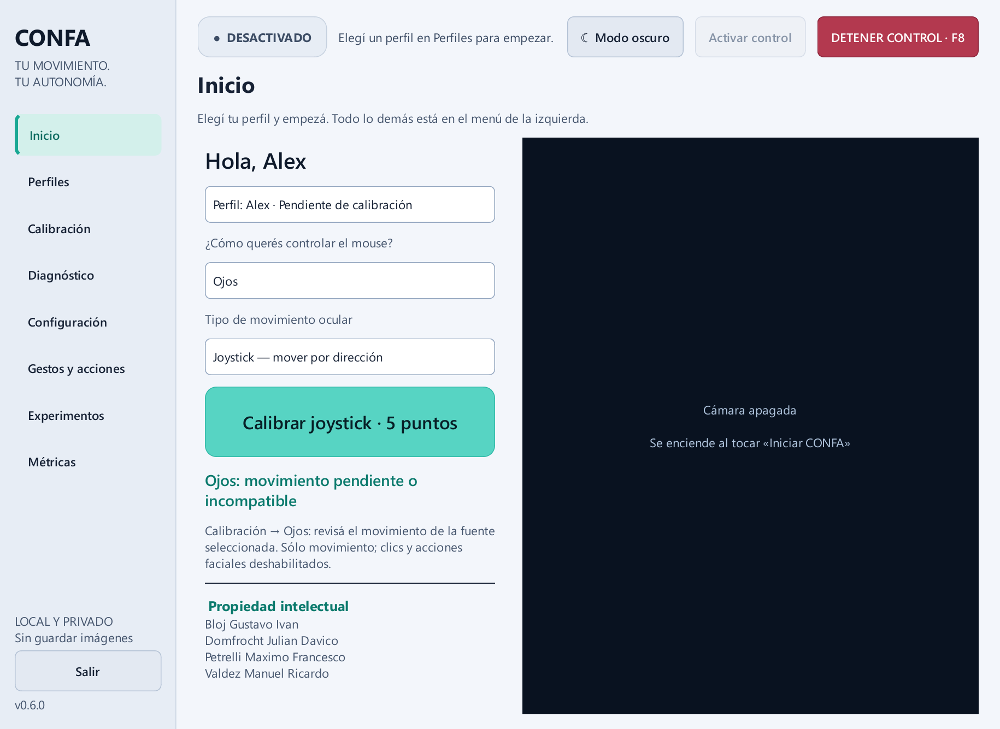
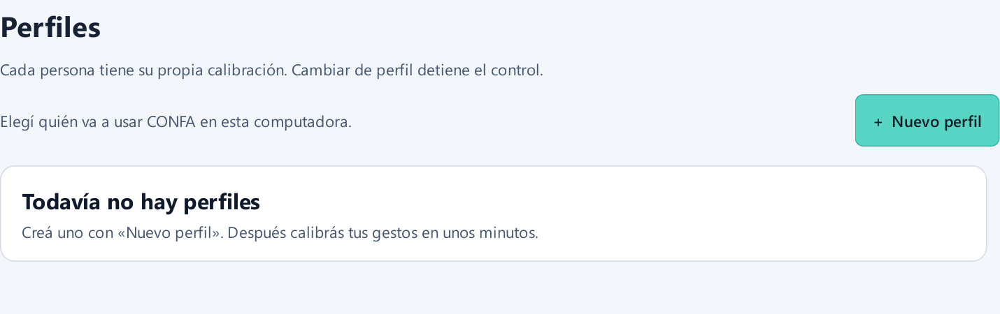
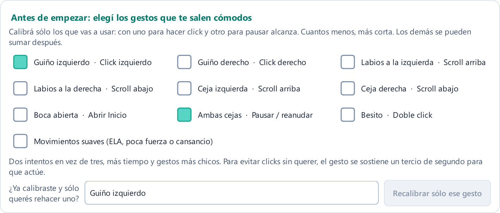
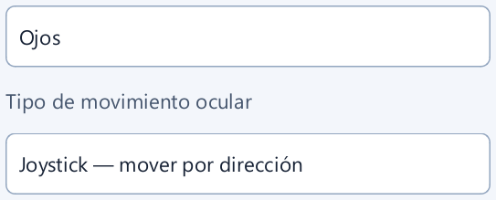
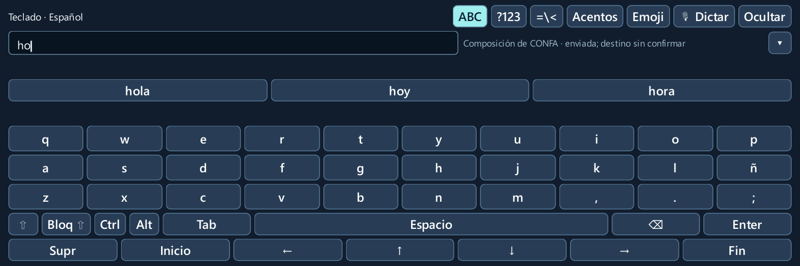
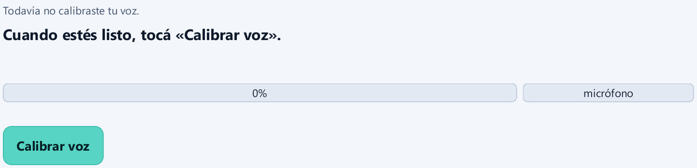
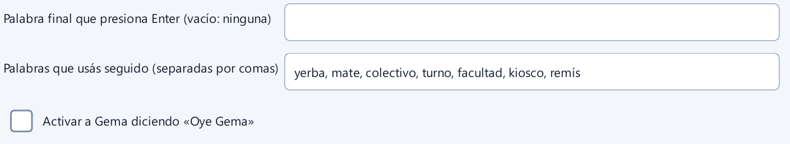
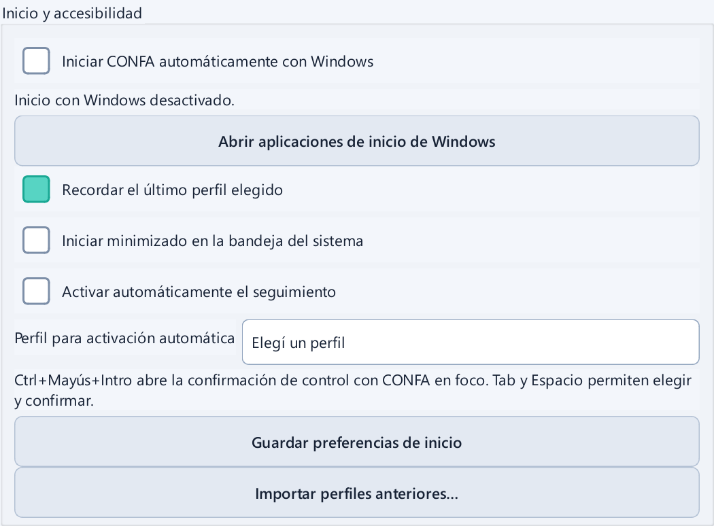
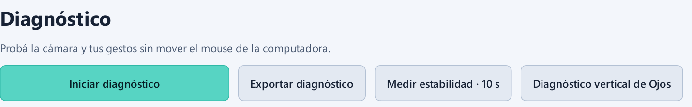

# CONFA

Guía de usuario para Windows · Versión 0.6.0

CONFA significa **Controlador Facial y Asistente de voz**. Con una webcam podés mover el puntero, elegir acciones con gestos y escribir. Si tenés micrófono, también podés dictar y pedirle a Gema que maneje funciones de Windows.

### Propiedad intelectual

Bloj Gustavo Ivan

Domfrocht Julian Davico

Petrelli Maximo Francesco

Valdez Manuel Ricardo

**Para detener el control y apagar la cámara**, usá **Detener control**. F8 permite hacerlo desde otra aplicación cuando está registrado en Windows.

## Instalar y crear el primer perfil

Necesitás Windows 10 de 64 bits (versión 2004 o posterior) o Windows 11, una webcam y luz suficiente para ver tu rostro. El micrófono se usa para las funciones de voz.

1. Abrí **CONFA-Setup-0.6.0-win64.exe** y seguí el asistente. Podés elegir un acceso en el escritorio. También vas a encontrar CONFA en el menú Inicio de Windows. El instalador incluye el entorno y los modelos necesarios para el uso local.
2. Abrí CONFA. En **Inicio**, tocá **Crear mi perfil**, o entrá en **Perfiles → Nuevo perfil**. Usá un nombre que reconozcas. Si varias personas comparten el equipo, creá un perfil para cada una.
3. Elegí **Nariz** u **Ojos**. Sentate de forma cómoda, con el rostro visible y la cámara estable. En **Calibración**, prepará el método elegido. Inicio te irá indicando cuándo podés empezar.
4. Para ajustar los colores, tocá **Modo claro** o **Modo oscuro** en la barra superior. Podés cambiar el tema con el control en marcha. El teclado flotante conserva su fondo oscuro.

### Si aparece «Cargar licencia»

En la edición que muestra ese botón, abrí **Cargar licencia** desde Inicio, o **Configuración → Licencia**. Cargá el archivo **.hmlic** que recibiste o pegá el texto de la licencia y tocá **Activar licencia**. Volvé a Inicio para continuar con el perfil. Este paso corresponde únicamente a las ediciones que muestran esa pantalla.

## Nariz y gestos cómodos

Elegí **Nariz** en Inicio y abrí **Calibración → Nariz**. El movimiento parte de una postura de descanso. Los gestos que marques servirán para ejecutar acciones como hacer clic o pausar.

1. Marcá los gestos que quieras usar. La selección inicial propone **guiño izquierdo** para hacer clic y **ambas cejas** para pausar o reanudar. Revisá la acción escrita al lado de cada casilla.
2. Si te cansás o tenés poco recorrido facial, marcá **Movimientos suaves** antes de empezar. Pide dos intentos por gesto, da más tiempo y admite gestos más pequeños. Durante el uso, sostené el gesto alrededor de un tercio de segundo para ejecutar su acción.
3. Tocá **Comenzar calibración**. Mirá la cámara en reposo cuando se indique y realizá el gesto pedido. En el modo habitual se miden tres repeticiones. Completá la prueba de reconocimiento y tocá **Guardar perfil** cuando esté disponible.
4. Para cambiar una sola medición, elegí el gesto en el selector inferior y pulsá **Recalibrar sólo ese gesto**. Medí, validá y guardá. Los demás gestos conservan sus valores.

**Para empezar a mover el puntero**, volvé a Inicio, elegí **Iniciar CONFA** y confirmá. Mantené una postura cómoda mientras se fija el centro. La mini cámara opcional muestra la nariz y la zona quieta. En **Gestos y acciones** podés revisar qué hace cada gesto en ese método.

## Ojos · Directo y Joystick

En **Inicio → Ojos**, elegí cómo querés mover el puntero. En **Calibración → Ojos**, elegí **Ambos ojos**, **Ojo izquierdo** u **Ojo derecho**. Cada fuente conserva su propio ajuste. Mantené la misma pantalla, cámara y postura durante la medición.

### Directo · señalar una posición

Mirá cada objetivo de pantalla cuando aparezca. Se usan nueve puntos para aprender el ajuste y cinco para comprobarlo. Revisá el resultado y guardalo cuando la aplicación lo permita. El puntero se dirige a la posición estimada de la mirada. El seguimiento ocular es experimental y la precisión puede variar entre personas y sesiones.

### Joystick · mover por dirección

Tocá **Calibrar joystick · 5 puntos** y seguí los cinco objetivos, uno por vez. Al activar, mirá primero la zona central. Después mirá hacia una de las cuatro marcas de los bordes para mover el puntero desde su posición actual. Volvé al centro para frenarlo. Si miraste fuera de la pantalla, volvé brevemente al centro para retomar.

Si una flecha queda gris, Inicio ofrece repetir ese eje con **tres puntos**. Una calibración parcial puede permitir movimiento reducido en el eje disponible, con los clics deshabilitados. **Recentrar mirada** ajusta el reposo y **Revertir recentrado** recupera el anterior. La calibración de gestos de Ojos se guarda por separado de la de Nariz.

## Escribir con el teclado virtual

Con el control activo, seleccioná un campo de texto. El teclado aparece cuando la aplicación reconoce el campo y está habilitada la apertura automática. También podés usar **Ctrl+Alt+K** o **Mostrar u ocultar teclado** en la bandeja.

1. Probalo en Bloc de notas. Elegí las letras con tu gesto de clic. **ABC**, **?123**, **Acentos** y **Emoji** cambian el grupo de teclas. Usá **Espacio**, **Enter** o retroceso como en un teclado físico.
2. Si escribís **ho** y aparece **hola**, tocá la sugerencia. Completa la palabra en el campo activo. La vista superior te ayuda a revisar qué escribió el teclado y si pudo comprobar el cursor.
3. En **Configuración → Básico → Predicción y aprendizaje de palabras**, marcá **Aprender palabras completas en este perfil** y guardá la configuración si querés que recuerde tu vocabulario. En **Administrar diccionario personal** podés eliminar una palabra o borrar el vocabulario del perfil.
4. **Ocultar** deja un botón flotante para recuperar el teclado. En **Configuración → Básico → Teclado virtual y escritura** podés ajustar tamaño, posición, opacidad y vista previa. Para selección por permanencia con Ojos, revisá la opción de permanencia y sus requisitos en **Configuración → Ojos**.

El aprendizaje es local y opcional. Los campos de contraseña o sensibles quedan en modo privado. Si un programa impide verificar el cursor, revisá el texto directamente en el destino. El dictado y el diccionario del teclado se configuran por separado.

## Dictar en un campo de texto

En **Configuración → Básico → Dictado por voz**, activá el dictado, elegí el micrófono y guardá la configuración. Si cambiaste de dispositivo, tocá **Buscar micrófonos**. Windows debe permitir el micrófono para las aplicaciones de escritorio.

### Preparar la voz

En **Calibración → Voz**, pulsá **Calibrar voz**. Hacé tres segundos de silencio, leé las cuatro frases indicadas y tocá **Guardar en mi perfil** al terminar. La medición ayuda a reconocer tu voz y el ruido del ambiente. En Configuración, **Small** es el modelo recomendado en la aplicación. **Base** o **Tiny** son alternativas para equipos más lentos. Podés agregar nombres propios y palabras frecuentes.

### Dictar y corregir

1. Iniciá el control manualmente. Abrí un borrador en Bloc de notas o WhatsApp, seleccioná el campo donde querés escribir y tocá **Dictar** en el teclado virtual. El botón usa el campo que reconoció el teclado, también en WhatsApp de escritorio.
2. Cuando aparezca **Escuchando…**, decí una frase. Un silencio termina la captura. También podés terminarla con tu gesto de clic o cancelarla con tu gesto de pausa. F8 detiene el control y la escucha.
3. Para editar, decí como frase independiente **«borrar dos palabras»**, **«borrar todo»** o **«deshacer»**. Revisá el texto antes de enviarlo. La opción de palabra final para pulsar Enter está vacía inicialmente.

Si cambiaste de ventana o de campo mientras hablabas, seleccioná otra vez el destino antes de volver a dictar. La escucha y la transcripción se procesan en la PC.

## Dar órdenes con Gema

Gema entiende comandos en español para manejar Windows. Para usarla, habilitá el dictado del perfil, guardá la configuración e iniciá el control manualmente.

### Llamarla con la voz o con un gesto

En **Configuración → Básico → Dictado por voz**, marcá **Activar a Gema diciendo «Oye Gema»** y guardá. Con el control activo y sin pausa, decí **«Oye Gema»**, esperá el pitido y hacé el pedido. También podés decir la orden completa, por ejemplo **«Oye Gema, subí el volumen»**.

Si te resulta más cómodo, asigná **Hablar con Gema** a un gesto en **Gestos y acciones**. Hacé el gesto, esperá **Gema te escucha…** y decí el pedido. La respuesta aparece en el aviso de la aplicación.

### Comandos para empezar

- **«Abrir Bloc de notas»** abre una aplicación del menú Inicio. Para abrir otro programa, usá su nombre.
- **«Minimizar»** actúa sobre la ventana que está adelante. **«Mostrar escritorio»** permite ver el escritorio de Windows.
- **«Subir volumen»**, **«silenciar»** y **«siguiente canción»** controlan el sonido y la reproducción.
- **«Qué hora es»** muestra la hora. **«Buscar recetas de empanadas»** abre una búsqueda web en el navegador.

El reconocimiento de la orden se hace localmente. La búsqueda web usa Internet. Cuando la llamada por voz está habilitada y el control está activo, el micrófono escucha la frase de activación. Otra persona cercana también puede decirla. Pausar o detener el control interrumpe esa escucha.

## Inicio con Windows y cierre

Después de guardar la primera calibración válida, podés elegir que CONFA se abra al iniciar sesión. Para cambiarlo después, entrá en **Configuración → Básico → Inicio y accesibilidad**.

- **Iniciar CONFA automáticamente con Windows** abre el programa al entrar en tu sesión. **Recordar el último perfil elegido** recupera tu selección. Pulsá **Guardar preferencias de inicio**.
- **Activar automáticamente el seguimiento** requiere autorización adicional, un perfil compatible y una señal estable. Elegí el perfil y confirmá si querés habilitarlo. El joystick ocular y el modo Directo requieren confirmación manual. Si movés la edición portable, abrila desde la nueva ruta y guardá de nuevo la preferencia de inicio.
- **Pausar** deja el seguimiento en pausa. **Detener control** o **F8** detienen la salida y apagan la cámara. Con CONFA en foco también podés usar **Escape**. **Ctrl+Mayús+Intro** abre la confirmación de activación desde el teclado. Usá Tab y Espacio para elegir y confirmar.
- **Salir completamente** en el menú de bandeja cierra la aplicación. Si elegiste iniciar minimizado, la X puede ocultar la ventana. Para volver, buscá CONFA entre los iconos de Windows. **Ver estado** indica si F8 está registrado globalmente.

## Diagnóstico, actualización y ayuda

En **Diagnóstico**, pulsá **Iniciar diagnóstico** para revisar la cámara y los gestos con el puntero del sistema detenido. Para pedir ayuda, **Exportar diagnóstico** guarda un ZIP con configuración, registros y señales numéricas. Revisá el contenido antes de compartirlo. Las capturas de esta guía usan un perfil y texto de ejemplo.

### Si algo no responde

- **Cámara ocupada o sin imagen.** Cerrá videollamadas y la app Cámara. Revisá el permiso de cámara para aplicaciones de escritorio en Windows y el dispositivo elegido en Configuración.
- **El joystick está activo y el cursor sigue quieto.** Mirá brevemente al centro, luego hacia una marca habilitada. Revisá si la flecha está gris y si Inicio pide repetir el eje. Si persiste, detené el control y exportá el diagnóstico.
- **Un gesto cuesta demasiado.** Revisá que esté seleccionado en el método correcto. Probá **Movimientos suaves** o **Recalibrar sólo ese gesto**. En **Métricas** podés revisar tus sesiones y en **Experimentos** hacer las tareas de prueba que ofrezca tu edición.
- **El teclado o el dictado no encuentran el campo.** Volvé a seleccionarlo y probá en Bloc de notas. Revisá el micrófono y sus permisos si la aplicación no recibe voz.

### Conservar los perfiles

Para actualizar, salí completamente y ejecutá el nuevo instalador. Los perfiles, calibraciones y diccionarios están en **%LOCALAPPDATA%\CONFA**, separados del programa. Con CONFA cerrado, podés copiar esa carpeta como respaldo. Si actualizás desde una versión anterior, CONFA busca tus datos al abrirse por primera vez.

Para recuperar perfiles de otra instalación, usá **Importar perfiles anteriores** en Inicio y accesibilidad. Para desinstalar, usá **Aplicaciones instaladas** de Windows. Los datos personales quedan disponibles para reinstalar.
